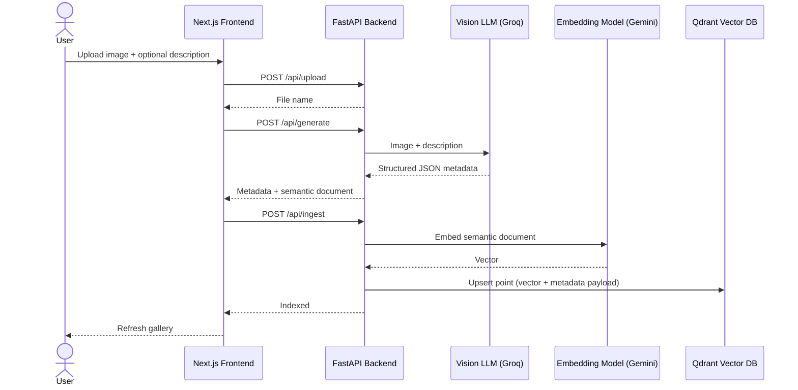

# Glimpse


**Glimpse is a semantic image search and ingestion engine powered by LLMs.**

Drop in an image, and a vision LLM describes it as structured metadata: people, objects, actions, setting, emotions, concepts, and the kinds of queries someone might use to find it. That metadata becomes a semantic document, which is embedded and stored in a vector database. You can then search your image library in plain language ("guy looking nervous in a meeting", "sunset over the ocean with a boat") instead of by filename or tag.

Glimpse ships as three pieces over one pipeline:

- **Ingestion pipeline**: vision LLM → structured metadata → semantic document → embedding → vector store.
- **Backend**: a FastAPI REST server and a Typer CLI that expose the same pipeline.
- **Frontend**: a dark-themed Next.js gallery to upload, review, browse, and search images.

---

## How It Works

Ingesting an image takes three steps. Each one saves its output to disk, so you can inspect or re-run any step on its own.

1. **Upload**: the image is saved to `backend/data/images/`.
2. **Generate**: the vision model (`VISION_MODEL`, served by Groq) looks at the image together with an optional user description. It returns JSON metadata validated against `RetrievalMetadata` (`backend/src/models.py`). The metadata goes to `data/metadata/<name>.json`. It is then rendered into a Markdown semantic document with the highest-signal fields first, saved to `data/semantic/<name>.md`.
3. **Ingest**: the semantic document is embedded with the embedding model (`EMBEDDING_MODEL`, served by Gemini) and upserted into Qdrant. The point ID is derived from the image contents, so re-ingesting the same image updates its point instead of creating a duplicate.

At search time, the query is embedded with the same model and matched against stored vectors by cosine similarity.

The user description is treated as a hint, not ground truth. The vision model is told to prefer what is actually visible and to ignore an incorrect description.

### Extracted Metadata

| Field | Meaning |
|-------|---------|
| `title`, `summary` | Short title and natural-language description |
| `people`, `objects`, `actions`, `setting`, `clothing`, `emotions` | What is visible in the image |
| `concepts`, `keywords` | Higher-level themes and searchable terms |
| `possible_search_queries` | Other ways someone might search for this image |
| `usage_contexts` | Where the image could be used (reactions, captions, articles, presentations) |

### Sequence Diagram



---

## Project Structure

```text
.
├── backend/
│   ├── data/
│   │   ├── images/          # Uploaded images
│   │   ├── metadata/        # Vision LLM metadata (JSON)
│   │   └── semantic/        # Semantic documents (Markdown)
│   ├── src/
│   │   ├── api.py           # FastAPI routes
│   │   ├── config.py        # Settings loaded from .env, data folders
│   │   ├── embeddings.py    # Embedding provider wrapper (Gemini)
│   │   ├── main.py          # Typer CLI
│   │   ├── models.py        # Pydantic models, LLM output coercion
│   │   ├── qdrant_db.py     # Vector store (ImageVectorStore)
│   │   ├── semantic.py      # Metadata to semantic document
│   │   ├── server.py        # Uvicorn entrypoint
│   │   └── vision.py        # Vision LLM wrapper (Groq)
│   └── pyproject.toml       # Python dependencies (uv)
├── frontend/
│   ├── app/
│   │   ├── page.tsx         # Gallery + search
│   │   ├── image/[id]/      # Image detail page
│   │   ├── components/      # Navbar, ImageCard, UploadDialog
│   │   └── lib/api.ts       # Typed backend client
│   └── next.config.ts       # Loads root .env, proxies /api and /images to the backend
├── .env.example             # Template for the shared root .env
├── docker-compose.yml       # Local Qdrant (data in backend/qdrant_storage)
└── README.md
```

---

## API

| Method | Route | Purpose |
|--------|-------|---------|
| `POST` | `/api/upload` | Save an image (multipart `file`) |
| `POST` | `/api/generate` | Run the vision LLM and build the semantic document (`filename`, `description`) |
| `POST` | `/api/ingest` | Embed and upsert into Qdrant (`filename`) |
| `GET` | `/api/search?q=...&limit=10` | Semantic search |
| `GET` | `/api/images` | List indexed images |
| `GET` | `/api/images/{id}` | Get one indexed image |
| `GET` | `/images/{filename}` | Serve the raw image file |

Interactive docs are at `http://localhost:8000/docs` while the backend is running.

---

## Getting Started

### Prerequisites

- Python 3.11+ and [uv](https://docs.astral.sh/uv/)
- [Bun](https://bun.sh/)
- Docker
- Groq and Gemini API keys

### 1. Configure

```bash
cp .env.example .env
```

Fill in the API keys. See [Environment Variables](#environment-variables).

### 2. Start Qdrant

From the project root:

```bash
docker compose up -d
```

### 3. Install Dependencies

```bash
cd backend && uv sync
cd ../frontend && bun install
```

### 4. Run

```bash
# Terminal 1: backend on http://localhost:8000
cd backend
uv run src/server.py

# Terminal 2: frontend on http://localhost:3000
cd frontend
bun run dev
```

### CLI

The CLI runs the same pipeline without the web UI. Run it from `backend/`:

```bash
uv run src/main.py generate data/images/sample.jpg "optional description"
uv run src/main.py ingest data/semantic/sample.md
uv run src/main.py search "person celebrating with confetti"
uv run src/main.py count
```

---

## Environment Variables

All settings live in one `.env` at the project root, shared by both apps: the backend loads it in `backend/src/config.py`, the frontend in `frontend/next.config.ts`. `.env.example` is the template.

| Variable | Required | Description |
|----------|----------|-------------|
| `GROQ_API_KEY` | Yes | Groq API key for the vision model |
| `GEMINI_API_KEY` | Yes | Gemini API key for embeddings |
| `VISION_MODEL` | Yes | Groq vision model ID, e.g. `meta-llama/llama-4-scout-17b-16e-instruct` |
| `EMBEDDING_MODEL` | Yes | Gemini embedding model ID, e.g. `gemini-embedding-001` |
| `EMBEDDING_DIMENSIONS` | Yes | Vector size, e.g. `1536`. Must match the Qdrant collection |
| `QDRANT_URL` | No | Default `http://localhost:6333` |
| `QDRANT_COLLECTION` | No | Default `images` |
| `BACKEND_URL` | No | Where the frontend proxies `/api` and `/images`. Default `http://localhost:8000` |

A Qdrant collection's vector size is fixed when the collection is created. If you change `EMBEDDING_MODEL` or `EMBEDDING_DIMENSIONS`, point `QDRANT_COLLECTION` at a new collection and re-ingest.

---

## Tech Stack

- **Backend**: Python, FastAPI, Uvicorn, Pydantic, Typer, Rich
- **Frontend**: Next.js (App Router), React, TypeScript, Tailwind CSS v4
- **Models**: vision LLM via Groq (default Llama 4 Scout), embeddings via Gemini (default `gemini-embedding-001`)
- **Vector DB**: Qdrant
- **Tooling**: uv, Bun, Docker Compose
