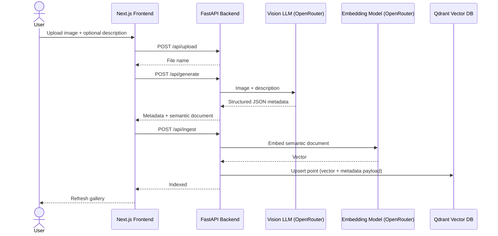

# Glimpse: Semantic Image Search Using Vision LLMs and Vector Embeddings

Project report content, organised by the report's table of contents.

---

## 1. Introduction

Digital image collections grow faster than people can organise them. Phones, screenshots, memes, reaction images, design assets and project photos pile up in folders where the only handles available are filenames (`IMG_2041.jpg`, `image (3).png`) and, at best, a few manual tags. When a user wants to find an image again, they usually remember **what it looked like or what it meant**, not what it was called: "the guy looking nervous in a meeting", "a sunset over the ocean with a boat", "that reaction image of someone facepalming".

Traditional search tools cannot answer such queries. Filename search depends on naming discipline, and tag search depends on someone having typed the exact word the user later searches for. Neither understands synonyms ("nervous" vs "anxious"), context ("office meeting" vs "conference room") or mood.

**Glimpse** is a semantic image search and ingestion engine that solves this by combining three recent technologies:

1. **Vision Large Language Models (Vision LLMs)** that can look at an image and describe it in rich, structured detail.
2. **Text embedding models** that convert text into vectors so that texts with similar meaning lie close to each other.
3. **Vector databases** that store those vectors and find the nearest ones to a query in milliseconds.

The core idea of the project is to **convert the image search problem into a text search problem**, and then solve the text search problem with embeddings. Every uploaded image is described by a vision LLM as structured JSON metadata (people, objects, actions, setting, clothing, emotions, concepts, keywords, likely search phrases and usage contexts). That metadata is rendered into a natural-language *semantic document*, embedded into a 1536-dimensional vector using OpenAI's `text-embedding-3-small` model (served through OpenRouter), and stored in the Qdrant vector database. At search time, the user's plain-language query is embedded with the same model and matched against the stored vectors by cosine similarity.

The system is delivered as a full-stack application: a Python FastAPI backend (with an equivalent Typer command-line interface) that runs the pipeline, and a dark-themed Next.js web interface where users upload, review, browse and search their images.

### 1.1 Purpose

The purpose of Glimpse is to let users **find images by meaning instead of by name**.

Specifically, the project aims to:

- Remove the need for manual tagging by having a vision LLM generate rich, consistent descriptions automatically.
- Allow natural-language search queries that match on meaning, synonyms, emotions and context, not only on exact keywords.
- Keep the generated descriptions **human-readable and inspectable**, so users can see why an image matched and correct the system when the AI is wrong.
- Demonstrate a practical, end-to-end application of modern AI building blocks (vision LLMs, structured outputs, embeddings and vector databases) in a working product, rather than as isolated experiments.

The project is particularly suited to collections where meaning matters more than pixels, such as memes and reaction images, where overlaid text, recognisable people and emotional context determine what a user will search for.

### 1.2 Objectives

1. **Automatic metadata generation**: Use a vision LLM to analyse each image, optionally guided by a user-supplied description, and produce structured metadata covering title, summary, people, objects, actions, setting, clothing, emotions, concepts, keywords, possible search queries and usage contexts.
2. **Reliable structured output**: Guarantee that the LLM output is valid, complete JSON by combining JSON-schema constrained decoding, Pydantic validation and a targeted retry strategy.
3. **Semantic document construction**: Convert the metadata into a natural-language Markdown document ordered by signal strength, optimised for embedding models.
4. **Vector indexing**: Embed each semantic document and store it in a vector database with its full metadata as payload, using deterministic, content-derived IDs so that re-ingesting an image never creates duplicates.
5. **Semantic search**: Let users search the library in plain English and return the most relevant images ranked by cosine similarity, with a visible relevance score.
6. **Human-in-the-loop review**: Show the generated metadata to the user before indexing, so incorrect descriptions can be caught.
7. **Usable interface**: Provide a responsive web gallery with drag-and-drop, file picker and clipboard-paste upload, a search bar, and a detail page for each image, plus a CLI for scripted use.
8. **Modular, replaceable design**: Isolate each external service (vision model, embedding model, vector database) behind its own module so that any one can be swapped by configuration or a single class change.

### 1.3 Scope

**In scope**

- Ingestion of common image formats (`.png`, `.jpg`, `.jpeg`, `.webp`) through a web UI or CLI.
- Vision-LLM-based metadata extraction via the OpenRouter API (default `z-ai/glm-5.3-flash`), with the model selectable through the `VISION_MODEL` environment variable.
- Text embeddings via OpenRouter (`openai/text-embedding-3-small`, 1536 dimensions).
- Vector storage and nearest-neighbour search in Qdrant, run locally in Docker.
- Persistence of every pipeline stage to disk (image, metadata JSON, semantic Markdown) so each stage can be inspected or re-run independently.
- REST API (`/api/upload`, `/api/generate`, `/api/ingest`, `/api/search`, `/api/images`, `/api/images/{id}`) with auto-generated OpenAPI documentation.
- Web interface: gallery, search with shareable URLs, three-step upload wizard with review, image detail page.
- Command-line interface: `generate`, `ingest`, `search`, `count`.

**Out of scope (current version)**

- Multi-user accounts, authentication and access control. The system is a single-user, locally hosted tool.
- Reverse image search (search by example image) and pixel-level similarity.
- Video, audio or document (PDF) indexing.
- Editing metadata inside the UI before ingestion, and deleting images from the UI.
- Large-scale deployment concerns such as sharding, background job queues and cloud object storage.
- Formal quantitative evaluation of retrieval quality on a labelled benchmark.

---

## 2. Literature Survey

| # | Work / Technology | Key idea | Relevance to Glimpse |
|---|---|---|---|
| 1 | **Content-Based Image Retrieval (CBIR)**, e.g. Smeulders et al., "Content-Based Image Retrieval at the End of the Early Years", IEEE TPAMI, 2000 | Retrieve images using low-level visual features (colour histograms, texture, shape). | Identified the **semantic gap**: low-level features do not capture what a user means. Glimpse closes this gap by describing images in language. |
| 2 | **Tag / keyword-based retrieval** (Flickr tags, file managers) | Images are found by manually assigned tags or filenames. | Cheap, but depends on manual effort and exact word matches; fails on synonyms. Glimpse automates the tagging and adds semantic matching. |
| 3 | **Word2Vec** (Mikolov et al., 2013) and **Sentence-BERT** (Reimers & Gurevych, 2019) | Dense vector representations where semantic similarity becomes geometric closeness. | Foundation for embedding-based semantic search used in Glimpse. |
| 4 | **Dense Passage Retrieval** (Karpukhin et al., 2020) | Separate query and passage encoders for open-domain retrieval outperform BM25. | Shows that dense embeddings outperform keyword matching for retrieval, the basis of Glimpse's search. |
| 5 | **CLIP** (Radford et al., "Learning Transferable Visual Models From Natural Language Supervision", 2021) | Joint image-text embedding space trained on 400M image-caption pairs; enables zero-shot text-to-image search. | The main alternative approach. Fast and cheap per image, but weak on overlaid text, named people and cultural context, and its vectors are not human-readable. Glimpse chooses captioning + text embeddings for explainability and richer context. |
| 6 | **BLIP / BLIP-2** (Li et al., 2022, 2023) | Image captioning and visual question answering with bootstrapped vision-language pre-training. | Shows that generated captions are a viable bridge between images and text retrieval. |
| 7 | **Large multimodal models**: GPT-4V (OpenAI, 2023), LLaVA (Liu et al., 2023), Llama 4 (Meta, 2025), GLM-V family (Zhipu AI) | LLMs that accept images and produce detailed, instruction-following descriptions. | Glimpse uses a vision LLM of this class (GLM 5.3 Flash, served by OpenRouter) to produce structured metadata. |
| 8 | **Structured outputs / constrained decoding** (JSON Schema mode in OpenAI-compatible APIs) | Constrain LLM generation to a given JSON schema. | Used in Glimpse to force every metadata field to be present and well-typed. |
| 9 | **Matryoshka Representation Learning** (Kusupati et al., NeurIPS 2022) | Train embeddings so that leading dimensions carry most information; vectors can be truncated with little quality loss. | `text-embedding-3-small` is trained this way and accepts a `dimensions` parameter, so the vector size can be reduced later without changing models. Glimpse uses its full 1536 dims. |
| 10 | **HNSW** (Malkov & Yashunin, "Efficient and robust approximate nearest neighbor search using Hierarchical Navigable Small World graphs", IEEE TPAMI, 2018) | Graph-based approximate nearest neighbour search with roughly logarithmic query time. | The index used internally by Qdrant for fast vector search. |
| 11 | **Vector databases**: FAISS (Johnson et al., 2017), Pinecone, pgvector, Qdrant | Storage and ANN search over embeddings. | Qdrant selected: open source, runs locally in Docker, stores JSON payload alongside vectors, supports filtering. |
| 12 | **Retrieval-Augmented Generation** (Lewis et al., 2020) and **query expansion** (Rocchio, 1971; doc2query, Nogueira et al., 2019) | Augment documents with likely queries to improve recall. | Glimpse asks the LLM for `possible_search_queries` and stores them in the semantic document: query expansion performed at index time. |

**Summary of findings**: Classical CBIR suffers from the semantic gap, and tag-based systems depend on manual effort. CLIP-style joint embeddings solve the gap partially but are opaque and weak on text-heavy or culturally specific images. Recent vision LLMs can produce rich, accurate descriptions, and modern text embeddings with vector databases make semantic text search fast and accurate. Combining these, with structured outputs for reliability, is the approach Glimpse takes.

---

## 3. Problem Definition

Users of personal or team image collections cannot efficiently find a specific image when they remember its **content or meaning** but not its filename or tags.

Existing approaches fall short:

- **Filename search** depends on meaningful names, which images from cameras, screenshots and downloads rarely have.
- **Manual tagging** is slow, inconsistent between people, and never anticipates every word a future searcher might use.
- **Keyword matching** fails on synonyms and paraphrases ("nervous" vs "anxious", "beach" vs "seaside").
- **Pixel/feature-based similarity (CBIR)** cannot answer abstract queries about emotions, actions, concepts or text written inside the image.
- **Direct multimodal embeddings (CLIP)** produce opaque vectors that cannot be inspected or corrected, and handle overlaid text, named people and meme context poorly.

Additionally, using an LLM to describe images introduces its own problems: the model may return malformed JSON, skip fields, return strings where lists are expected, fall into repetition loops, or hallucinate details. A practical system has to handle these failure modes.

**Problem statement**: Design and implement a system that automatically generates rich, structured, human-readable descriptions of images using a vision LLM, indexes those descriptions as semantic vectors, and allows users to retrieve images through natural-language queries ranked by semantic similarity, while keeping LLM output reliable and allowing human review before indexing.

---

## 4. Proposed System

Glimpse is a three-tier system built around one ingestion and retrieval pipeline.

### System architecture

```text
 Browser (Next.js, :3000)
   │   /api/*  and  /images/*   (Next.js rewrites = reverse proxy)
   ▼
 FastAPI backend (:8000)  ──── Typer CLI (same pipeline, no web)
   │          │            │
   ▼          ▼            ▼
 OpenRouter   OpenRouter    Qdrant (Docker, :6333)
 vision LLM   embeddings    vector store
   │
   ▼
 backend/data/{images, metadata, semantic}   (files on disk)
```

| Layer | Technology | Role |
|---|---|---|
| Presentation | Next.js 16, React 19, TypeScript, Tailwind CSS v4 | Gallery, search bar, upload wizard, detail page |
| Application | Python 3.11+, FastAPI, Uvicorn, Pydantic v2, Typer | REST API and CLI over a shared pipeline |
| AI services | OpenRouter (vision LLM and embeddings) | Image understanding and text vectorisation |
| Storage | Qdrant (vectors + payload), local filesystem | Persistence of vectors, images, metadata and documents |

### Modules

1. **Upload module**: accepts an image (drag-and-drop, file picker or clipboard paste), sanitises the filename and saves it to `data/images/`.
2. **Vision module** (`vision.py`): sends the image and optional user description to the vision LLM with a detailed system prompt and a JSON schema; validates and retries; saves metadata to `data/metadata/<name>.json`.
3. **Semantic document module** (`semantic.py`): renders metadata into ordered Markdown and saves it to `data/semantic/<name>.md`.
4. **Embedding module** (`embeddings.py`): wraps the OpenRouter embeddings API; methods for documents, queries and batches.
5. **Vector store module** (`qdrant_db.py`): creates the collection, derives deterministic point IDs, upserts, searches and counts points.
6. **API module** (`api.py`): exposes the pipeline as REST endpoints and serves raw image files.
7. **CLI module** (`main.py`): exposes the same pipeline for batch and scripted use.
8. **Frontend**: gallery and search page, image detail page, upload dialog implemented as a finite state machine (`upload → generating → review → ingesting → done`).

### Data flow



### Key design decisions

- **Caption-then-embed instead of CLIP**: metadata is human-readable, editable and explains matches; handles text in images, named people and memes.
- **Semantic document instead of raw JSON**: embedding models are trained on natural language; braces and keys add noise. Highest-signal fields come first.
- **Index-time query expansion**: `possible_search_queries` puts phrasings users are likely to type directly into the indexed text.
- **Every stage saved to disk**: allows re-embedding without new vision calls and rebuilding the whole index if the embedding model changes.
- **Content-derived IDs**: SHA-256 of image bytes means re-ingest is idempotent and duplicates are impossible.
- **Fail-fast configuration**: missing API keys or model names raise an error at startup, not mid-request.

### 4.1 Algorithm

**Algorithm 1: Image ingestion**

```
Input : image file I, optional user description D
Output: point stored in vector database

1.  name ← basename(I.filename)                     // blocks path traversal
2.  save I to IMAGES_DIR / name
3.  encoded ← base64(I)
4.  schema ← JSON schema of RetrievalMetadata with every field required
5.  sparse ← null
6.  for attempt ← 1 to MAX_ATTEMPTS (= 3) do
7.      try
8.          response ← VisionLLM(system_prompt, D, encoded, schema)
9.          M ← validate(parse_json(response))       // Pydantic; coerces string→list
10.     catch json_validate_failed, JSONDecodeError, ValidationError
11.         continue
12.     if length(M.title) > 120 then continue        // repetition loop
13.     if any list field of M is non-empty then
14.         goto STORE
15.     sparse ← M                                    // only title + summary
16. end for
17. if sparse ≠ null then M ← sparse
18. else raise VisionError                            // HTTP 502
STORE:
19. save M as METADATA_DIR / stem(name).json
20. S ← BuildSemanticDocument(M, D)                   // Algorithm 2
21. save S as SEMANTIC_DIR / stem(name).md
22. (user reviews M and S, then confirms)
23. v ← Embed(S, dims = 1536)
24. id ← UUIDv4_bits( SHA256(bytes(I))[0:16] )        // deterministic
25. Qdrant.upsert(id, v, payload = {filename, path, S, M})
```

**Algorithm 2: Semantic document construction**

```
Input : metadata M, user description D
Output: Markdown text S

1. sections ← [ "# " + M.title, "## Summary\n" + M.summary ]
2. if D not empty then append "## User Description\n" + D
3. for field in [people, actions, objects, setting, clothing,
                 emotions, concepts, keywords,
                 possible_search_queries, usage_contexts] do
4.     if M.field not empty then
5.         append "## " + heading(field) + "\n" + bullet_list(M.field)
6. S ← join(sections, "\n\n")
```

Fields are ordered from highest to lowest semantic signal, and empty sections are skipped so they add no noise to the embedding.

**Algorithm 3: Semantic search**

```
Input : query text q, result limit k (default 10)
Output: top-k images with similarity scores

1. u ← Embed(q, dims = 1536)                                // same model as documents
2. results ← Qdrant.query_points(collection, u, limit = k)   // HNSW ANN
3. for each r in results:
4.     score(r) = cos(u, v_r) = (u · v_r) / (‖u‖ ‖v_r‖)
5. return results sorted by score descending, each with payload
```

**Complexity**: embedding the query is one API call, independent of collection size. HNSW search is approximately O(log n) in the number of indexed images, compared with O(n·d) for brute-force comparison over n vectors of dimension d = 1536.

---

## 5. Technology Stack

| Category | Technology | Purpose |
|---|---|---|
| Backend language | **Python 3.11+** | Pipeline, API and CLI |
| Package manager (Python) | **uv** | Fast, lockfile-based dependency management (`pyproject.toml`, `uv.lock`) |
| Web framework | **FastAPI** (≥ 0.115) | REST API with type-hint validation and automatic OpenAPI docs at `/docs` |
| ASGI server | **Uvicorn** | Serves the FastAPI app on port 8000 |
| Data validation | **Pydantic v2** | `RetrievalMetadata` model: JSON schema for the LLM, validation, serialisation, API response models |
| CLI | **Typer** + **Rich** | `generate`, `ingest`, `search`, `count` commands with formatted terminal output |
| Configuration | **python-dotenv** | Single shared `.env` at the project root |
| Model gateway | **OpenRouter** (`openai` SDK, OpenAI-compatible API) | One API key and one client for both the vision and embedding models |
| Vision LLM | **GLM 5.3 Flash** (`z-ai/glm-5.3-flash`) | Image + text input, JSON-schema structured output; model set by `VISION_MODEL` |
| Embeddings | **OpenAI** `text-embedding-3-small` (via OpenRouter) | 1536-dimensional text embeddings |
| Vector database | **Qdrant** (`qdrant-client`) | Stores vectors and JSON payload; cosine distance; HNSW index |
| Containerisation | **Docker**, Docker Compose | Runs Qdrant locally with persistent storage |
| Frontend framework | **Next.js 16** (App Router) | Routing, dynamic routes, rewrites as a reverse proxy to the backend |
| UI library | **React 19** | Component-based UI |
| Language (frontend) | **TypeScript 5** | Typed API client mirroring the Pydantic models |
| Styling | **Tailwind CSS v4** | Utility-first styling with `@theme` design tokens (dark theme) |
| Runtime / package manager (JS) | **Bun** | Installs and runs the frontend |
| Linting | **ESLint 9** | Frontend code quality |
| Version control | **Git** | Source control |

---

## 6. Implementation

### 6.1 Project structure

```text
.
├── backend/
│   ├── data/{images, metadata, semantic}/
│   ├── src/
│   │   ├── api.py           # FastAPI routes
│   │   ├── config.py        # Settings from .env, data folders
│   │   ├── embeddings.py    # OpenRouter embedding provider
│   │   ├── main.py          # Typer CLI
│   │   ├── models.py        # Pydantic models
│   │   ├── qdrant_db.py     # ImageVectorStore
│   │   ├── semantic.py      # Metadata → semantic document
│   │   ├── server.py        # Uvicorn entrypoint
│   │   └── vision.py        # Vision LLM wrapper
│   └── pyproject.toml
├── frontend/
│   └── app/
│       ├── page.tsx              # Gallery + search
│       ├── image/[id]/page.tsx   # Detail page
│       ├── components/           # Navbar, ImageCard, UploadDialog
│       └── lib/api.ts            # Typed backend client
├── docker-compose.yml            # Qdrant
├── setup.py                      # Creates .env (--it prompts for values)
└── .env.example
```

### 6.2 Configuration (`config.py`)

A single `.env` file at the project root is read by both the backend (`python-dotenv`) and the frontend (`@next/env` in `next.config.ts`). A `setup.py` script in the root creates `.env` from `.env.example` (`uv run setup.py`, or `uv run setup.py --it` to prompt for each value). The backend validates `OPENROUTER_API_KEY`, `VISION_MODEL`, `EMBEDDING_MODEL` and `EMBEDDING_DIMENSIONS` at import time and raises `RuntimeError` if any is missing (fail-fast). Data folders are created automatically.

### 6.3 Metadata model (`models.py`)

`RetrievalMetadata` is the single source of truth for an image's description:

| Field | Type | Meaning |
|---|---|---|
| `title` | string | Short descriptive title (≤ 12 words) |
| `summary` | string | Natural-language description |
| `people`, `objects`, `actions`, `setting`, `clothing`, `emotions` | list of strings | What is visible |
| `concepts`, `keywords` | list of strings | Higher-level themes and searchable terms |
| `possible_search_queries` | list of strings | Other ways someone might search for the image |
| `usage_contexts` | list of strings | Where the image could be used |

The same model generates the JSON schema sent to the LLM, validates the LLM response, serialises metadata to disk and defines API responses. A `model_validator(mode="before")` coerces common LLM quirks: a bare string where a list is expected becomes a one-item list, and the legacy field name `meme_contexts` is migrated to `usage_contexts`.

### 6.4 Vision module (`vision.py`)

- The image is base64-encoded and sent as a `data:` URL inside an OpenAI-compatible chat message, together with the user description.
- A detailed system prompt instructs the model to treat the user description as a hint, not ground truth; to prefer what is visible; not to invent facts; and to fill every field.
- `response_format={"type": "json_schema", ...}` constrains generation to the Pydantic schema. The schema is patched so that **every field is required**, because the model otherwise treats fields with defaults as optional and skips them.
- A retry loop (`MAX_ATTEMPTS = 3`) handles: provider-side JSON validation errors, empty responses, JSON decode errors, Pydantic validation errors, titles longer than 120 characters (a sign of a repetition loop) and "sparse" responses with only title and summary (kept as a fallback).
- If every attempt fails, `VisionError` is raised and the API returns **HTTP 502 Bad Gateway**.

### 6.5 Semantic document (`semantic.py`)

`build_semantic_document()` renders metadata as Markdown in signal order (title, summary, user description, people, actions, objects, setting, clothing, emotions, concepts, keywords, alternative search phrases, usage contexts), skipping empty sections.

### 6.6 Embeddings (`embeddings.py`)

`OpenRouterEmbeddingProvider` is the only class that knows how the embedding provider works (adapter pattern). It calls the OpenAI-compatible `embeddings.create` endpoint on OpenRouter with `dimensions=1536`. `embed_document()` and `embed_query()` embed single texts; `embed_documents()` embeds a batch. `text-embedding-3-small` has no separate query/document modes, so both sides use the same embedding.

### 6.7 Vector store (`qdrant_db.py`)

`ImageVectorStore` (repository pattern over Qdrant):

- `ensure_collection()` creates the collection with vector size `EMBEDDING_DIMENSIONS` and `Distance.COSINE` if it does not exist.
- `image_id()` derives a deterministic UUID from the SHA-256 of the image bytes:

  ```python
  digest = sha256(path.read_bytes()).digest()
  return str(UUID(bytes=digest[:16], version=4))
  ```

- `upsert()` embeds the semantic document and stores a point with the vector and a payload containing filename, path, semantic document and all metadata fields.
- `search()` embeds the query and calls `query_points` for the top-k nearest points.
- `count()` and `delete()` support administration.

### 6.8 REST API (`api.py`)

| Method | Route | Purpose |
|---|---|---|
| `POST` | `/api/upload` | Save an image (multipart `file`) |
| `POST` | `/api/generate` | Run the vision LLM and build the semantic document |
| `POST` | `/api/ingest` | Embed and upsert into Qdrant |
| `GET` | `/api/search?q=...&limit=10` | Semantic search |
| `GET` | `/api/images` | List indexed images |
| `GET` | `/api/images/{id}` | Get one indexed image |
| `GET` | `/images/{filename}` | Serve the raw image file (`StaticFiles`) |

CORS is restricted to `http://localhost:3000`. Errors map to HTTP 400 (bad input), 404 (not found) and 502 (upstream AI service failure).

### 6.9 CLI (`main.py`)

```bash
uv run src/main.py generate data/images/<name>.png "optional user description"
uv run src/main.py ingest data/semantic/<name>.md
uv run src/main.py search "guy looking nervous in a meeting" --limit 10
uv run src/main.py count
```

### 6.10 Frontend

- **`next.config.ts`**: rewrites `/api/*` and `/images/*` to the backend, so the browser only talks to its own origin (no CORS issues; backend URL set by `BACKEND_URL`).
- **`lib/api.ts`**: typed fetch client whose TypeScript interfaces mirror the Pydantic models.
- **Gallery (`page.tsx`)**: lists indexed images or search results. The query lives in the URL (`/?q=...`), so results are shareable, bookmarkable and work with the back button.
- **Navbar**: brand, search form and Upload button.
- **UploadDialog**: finite state machine `upload → generating → review → ingesting → done`, with drag-and-drop, file picker and clipboard paste (pasted images are renamed `pasted-<timestamp>.png` to avoid overwriting). The dialog cannot be closed mid-request.
- **ImageCard**: grid tile with a similarity score badge shown for search results.
- **Detail page (`image/[id]/page.tsx`)**: dynamic route keyed by the Qdrant point UUID; shows the image, all metadata tags and the semantic document.
- **Theme**: dark, Spotify-inspired palette (accent `#1ed760`, surfaces `#121212` / `#181818`) using Tailwind v4 `@theme` tokens; font Bricolage Grotesque.

### 6.11 Running the system

```bash
uv run setup.py --it             # creates .env, asks for the OpenRouter API key
docker compose up -d              # start Qdrant
cd backend && uv sync && uv run start             # API on :8000
cd frontend && bun install && bun run dev          # UI on :3000
```

---

## 7. Results

> Add screenshots here: gallery view, upload dialog (review step), search results with scores, image detail page, Swagger UI at `/docs`, Qdrant dashboard at `http://localhost:6333/dashboard`.

**Functional results**

- Images can be uploaded via drag-and-drop, file picker or clipboard paste, described by the vision LLM, reviewed and indexed in a single guided flow.
- For each image, the system produces structured metadata with all twelve fields populated, a readable semantic document, and a stored vector in Qdrant.
- Natural-language queries return ranked results with a similarity score shown as a percentage badge on each image card.
- **Semantic matching works beyond keywords**: queries using words that do not literally appear in the metadata (synonyms or moods, e.g. "anxious" for an image tagged "nervous") still retrieve the relevant image, because matching happens in embedding space.
- Re-ingesting the same image updates its existing point instead of creating a duplicate, confirmed by the stable point count (`count` command).
- The same pipeline works identically from the CLI and the web UI.

**Reliability results**

- JSON-schema structured output, the required-field schema patch, Pydantic coercion and the retry loop together turned the most common LLM failure modes (missing fields, strings instead of lists, malformed JSON, repetition loops in titles) into recoverable events. When all attempts fail, the user receives a clear HTTP 502 error rather than a crash.
- Deliberately misleading user descriptions are overridden by what is visible in the image, as instructed by the system prompt.

**Performance observations**

- Search latency is dominated by a single embedding API call; Qdrant's HNSW search over the collection is effectively instantaneous at project scale.
- Ingestion latency is dominated by the vision LLM call (a few seconds per image), which is a one-time cost per image.

> Optional: add a small table of sample queries, the top result returned, and its score.

| Query | Top result (title) | Score |
|---|---|---|
| _e.g. "guy looking nervous in a meeting"_ | | |
| _e.g. "sunset over the ocean with a boat"_ | | |
| _e.g. "celebration with friends"_ | | |

---

## 8. Conclusion

Glimpse demonstrates that the semantic gap in image retrieval can be bridged effectively by **turning images into text and searching that text by meaning**. A vision LLM generates rich, structured, human-readable metadata for each image; a carefully ordered semantic document turns that metadata into embedding-friendly text; OpenAI embeddings and the Qdrant vector database then provide fast, accurate natural-language search.

The project achieved its objectives: automatic metadata generation without manual tagging, reliable structured LLM output through schema constraints, validation and retries, idempotent indexing through content-derived IDs, semantic search that understands synonyms and moods, and a complete, usable web and command-line interface with human review before indexing.

Compared with direct multimodal embeddings such as CLIP, the chosen design trades a higher one-time cost per image for explainable, editable metadata and better handling of text in images, named people and cultural context, which suits collections like memes and reaction images. The modular design means each AI component can be replaced by changing configuration or a single class, so the system can adopt better models as they appear.

---

## 9. Future Scope

1. **Hybrid search**: combine dense vectors with sparse keyword search (BM25 or SPLADE), fused with Reciprocal Rank Fusion, to better match exact names and quoted meme text.
2. **Metadata filters**: use Qdrant payload filtering (e.g. by person, emotion or setting) alongside vector search.
3. **Re-ranking**: re-order the top results with a cross-encoder or an LLM for higher precision.
4. **Reverse image search**: store a CLIP image vector as a second named vector per point to support search by example image.
5. **Editable review step**: let users correct generated metadata before ingestion, and delete images from the UI.
6. **Scalability**: asynchronous clients, a background job queue for vision calls, batch embedding during bulk ingestion, pagination, thumbnails, object storage (e.g. S3) for images, Qdrant quantisation and sharding.
7. **Security and multi-user support**: authentication, per-user collections, upload type and size validation, stricter path validation on all endpoints.
8. **Evaluation**: build a labelled query-to-image dataset and measure Recall@k, Precision@k, MRR and nDCG; compare variants such as with and without `possible_search_queries`.
9. **Broader media**: extend the pipeline to video (keyframe captioning), screenshots with OCR, and documents.
10. **Deployment**: containerise the backend and frontend alongside Qdrant in Docker Compose and add automated tests and CI.

---

## References

1. A. W. M. Smeulders, M. Worring, S. Santini, A. Gupta and R. Jain, "Content-Based Image Retrieval at the End of the Early Years," *IEEE Transactions on Pattern Analysis and Machine Intelligence*, vol. 22, no. 12, pp. 1349–1380, 2000.
2. T. Mikolov, K. Chen, G. Corrado and J. Dean, "Efficient Estimation of Word Representations in Vector Space," arXiv:1301.3781, 2013.
3. N. Reimers and I. Gurevych, "Sentence-BERT: Sentence Embeddings using Siamese BERT-Networks," *Proc. EMNLP-IJCNLP*, 2019.
4. V. Karpukhin et al., "Dense Passage Retrieval for Open-Domain Question Answering," *Proc. EMNLP*, 2020.
5. A. Radford et al., "Learning Transferable Visual Models From Natural Language Supervision," *Proc. ICML*, 2021.
6. J. Li, D. Li, S. Savarese and S. Hoi, "BLIP-2: Bootstrapping Language-Image Pre-training with Frozen Image Encoders and Large Language Models," *Proc. ICML*, 2023.
7. H. Liu, C. Li, Q. Wu and Y. J. Lee, "Visual Instruction Tuning (LLaVA)," *Proc. NeurIPS*, 2023.
8. A. Kusupati et al., "Matryoshka Representation Learning," *Proc. NeurIPS*, 2022.
9. Y. A. Malkov and D. A. Yashunin, "Efficient and Robust Approximate Nearest Neighbor Search Using Hierarchical Navigable Small World Graphs," *IEEE TPAMI*, vol. 42, no. 4, pp. 824–836, 2018.
10. J. Johnson, M. Douze and H. Jégou, "Billion-scale similarity search with GPUs (FAISS)," arXiv:1702.08734, 2017.
11. P. Lewis et al., "Retrieval-Augmented Generation for Knowledge-Intensive NLP Tasks," *Proc. NeurIPS*, 2020.
12. R. Nogueira, W. Yang, J. Lin and K. Cho, "Document Expansion by Query Prediction (doc2query)," arXiv:1904.08375, 2019.
13. FastAPI documentation, https://fastapi.tiangolo.com/
14. Pydantic documentation, https://docs.pydantic.dev/
15. Qdrant documentation, https://qdrant.tech/documentation/
16. OpenRouter documentation, https://openrouter.ai/docs
17. OpenAI, "New embedding models and API updates" (text-embedding-3), https://openai.com/index/new-embedding-models-and-api-updates/
18. Next.js documentation, https://nextjs.org/docs
19. Tailwind CSS documentation, https://tailwindcss.com/docs
20. uv documentation, https://docs.astral.sh/uv/
